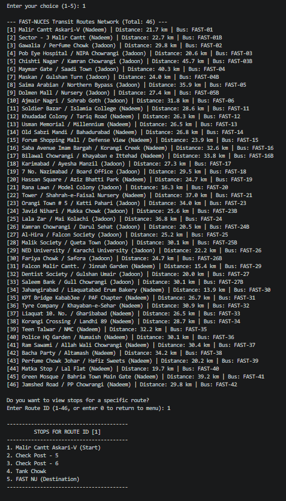

# PF-Lab-Project-Fast_Transit_System
Automated university transport management system built with C and HTML.
# FAST-Transit: Automated University Transport System

## Section A: Project Introduction
The FAST-Transit Automated System is a console-based application developed in C language to digitize and streamline the university bus registration and fare calculation process for FAST-NUCES Karachi campus. It replaces error-prone manual paperwork by accurately mapping 46 optimized transit routes, computing distance-based fares with a base rate and per-kilometer fee, handling membership tiers (Standard vs. PRO with live ETA), applying semesterly bulk discounts, and permanently storing student pass records using file handling.

---

## Section B: Features & Test Cases (Execution Scenarios)

### Case 1: View Available Routes & Distances
* **Description:** Tests the system's ability to read and display the complete network of 46 mapped transit routes from the external `routes.txt` data file along with specific stop details.
* **Inputs:** Selecting option `1` from the main menu and optionally entering a valid Route ID (e.g., `1` to `46`).
* **Expected Output:** Displays a formatted list of all routes with distances and bus numbers, followed by sequential route stops.
* **Screenshot:** 

### Case 2: Student Registration & Fare Calculation
* **Description:** Tests student input validation, automatic distance fetching, membership tier additions, and payment discount calculations.
* **Inputs:** Entering student credentials (name, email, contact), selecting Route ID, choosing Tier (Standard/PRO), and selecting Payment Mode (Monthly / Semesterly Upfront).
* **Expected Output:** Generates a complete fare breakdown summary showing exact installment or upfront semester fare.
* **Screenshot:** 

### Case 3: Save Record & Generate Transport Pass
* **Description:** Tests the file-handling capability to permanently store the registered student's session data into `transit_records.txt`.
* **Inputs:** Selecting option `3` from the main menu after successfully completing student registration (Option 2).
* **Expected Output:** Appends the record securely and displays a success message: `[Success] Student record saved permanently to 'transit_records.txt'!`
* **Screenshot:** 

### Case 4: View All Saved Student Records
* **Description:** Tests the retrieval and display of all previously saved student passes from the external file database.
* **Inputs:** Selecting option `4` from the main menu.
* **Expected Output:** Opens `transit_records.txt` and lists all stored student records line by line in a clean structured format.
* **Screenshot:** 

### Case 5: Invalid Input & Error Handling
* **Description:** Tests how the robust input scanner and file-checking mechanism respond to incorrect choices or missing files.
* **Inputs:** Entering non-numeric characters for menu choices, entering an out-of-range Route ID (e.g., `99`), or trying to save before registering.
* **Expected Output:** Displays a user-friendly error message (e.g., `[Error] Invalid input!` or `[Error] No student registered yet!`) and prompts safely without crashing.
* **Screenshot:** 

---

## Instructions to Clone and Execute

Follow these step-by-step terminal instructions to clone, compile, and run the project on your local machine:

### Step 1: Clone the Repository
Open your terminal or command prompt and run:
```bash
git clone [https://github.com/your-username/fast_transit_system.git](https://github.com/your-username/fast_transit_system.git)
cd fast_transit_system
