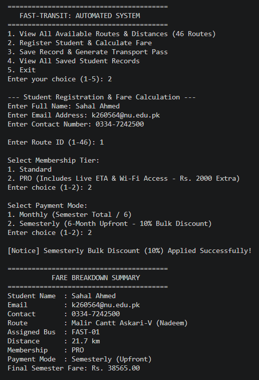

# FAST-TRANSIT: Automated System

## Section A: Project Introduction
**FAST-TRANSIT: Automated System** is a console-based transport management application developed in the C programming language for FAST-NUCES Karachi students. The core objective of this project is to digitize and streamline university point bus operations across 46 distinct routes by replacing manual registration and fare estimation with an automated, error-resistant system. Implemented using core C programming paradigms—including structures, file handling (`fopen`, `fgets`, `sscanf`, `fprintf`), conditional logic, loops, and string manipulation—the application allows users to browse all 46 routes with distances and assigned buses, inspect route-specific pitstops, calculate dynamic fares based on distance, membership tiers (Standard vs. PRO with live ETA and Wi-Fi), and payment modes (Monthly vs. Semesterly with a 10% bulk discount), and permanently store or retrieve student transport pass records in external text files (`routes.txt` and `transit_records.txt`).

---

## Section B: Features & Test Cases (Execution Scenarios)

### Case 1: Viewing All Routes & Inspecting Route Pitstops
* **Description:** Tests file reading from `routes.txt` to display all 46 university routes along with their distances and bus numbers, followed by conditional lookup of specific route pitstops.
* **Inputs:**
  * Menu Choice: `1`
  * Route ID for stops: `1`
* **Expected Output:** Displays all 46 routes formatted with ID, route name, distance in km, and bus number, followed by the specific list of stops for Route ID `1` (Malir Cantt Askari-V to FAST NU).
* **Screenshot:** 

### Case 2: Student Registration & Dynamic Fare Calculation
* **Description:** Validates user data capture into a `Student` struct, verifies the selected Route ID against `routes.txt`, and computes the final fare based on distance, membership tier, and payment mode.
* **Inputs:**
  * Menu Choice: `2`
  * Full Name: `Ali Khan`
  * Email: `k260000@nu.edu.pk`
  * Contact: `0300-1234567`
  * Route ID: `1`
  * Membership Tier: `2` (PRO)
  * Payment Mode: `2` (Semesterly Upfront)
* **Expected Output:** Applies the Rs. 2,000 PRO tier fee and 10% semesterly bulk discount, then displays a complete Fare Breakdown Summary showing assigned bus (`FAST-01`) and final discounted semester fare (`Rs. 38565.00`).
* **Screenshot:** 

### Case 3: Saving Student Pass Record & Viewing Saved Records
* **Description:** Tests permanent data persistence by appending the registered student's details to `transit_records.txt` and reading back all saved records from the file.
* **Inputs:**
  * Menu Choice: `3` (Save Record)
  * Menu Choice: `4` (View All Saved Student Records)
* **Expected Output:** Displays `[Success] Student record for 'Ali Khan' saved permanently to 'transit_records.txt'!` for Option 3, and lists all stored student pass records cleanly under `SAVED STUDENT PASS RECORDS` for Option 4.
* **Screenshot:** 

### Case 4: Invalid Input & Unregistered Save Error Handling
* **Description:** Verifies how the program handles invalid menu choices, out-of-range Route IDs, and attempts to save a record before completing registration.
* **Inputs:**
  * Menu Choice: `9` (Invalid menu option)
  * Menu Choice: `3` (Before registering a student)
  * Route ID: `99` (Out-of-range route during registration)
* **Expected Output:** Displays clear, user-friendly error messages (`[Error] Invalid choice! Please select between 1 and 5.`, `[Error] No student registered yet! Please complete Option 2 first.`, and `[Error] Invalid Route ID selected!`) without crashing.
* **Screenshot:** 

---

## Instructions to Clone and Execute

### Step 1: Clone the Repository
Open your terminal and execute:
```bash
git clone [https://github.com/](https://github.com/)sahalahmed-work/PF-Lab-Project-Fast_Transit_System.git
cd fast_transit_system
```

### Step 2: Compile the Code
Ensure `main.c` and `routes.txt` are in the same directory, then compile using GCC:
```bash
gcc main.c -o fast_transit
```

### Step 3: Run the Program
**Windows (Command Prompt):**
```cmd
fast_transit.exe
```
